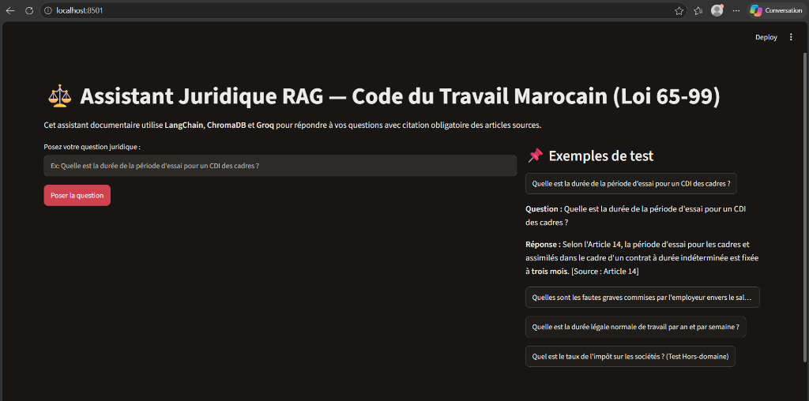

# Assistant RAG Juridique — Code du Travail Marocain (Loi 65-99)
**ENSAM Casablanca — Module : Transformers & LLMs (TP 4 : Assistant documentaire RAG avec évaluation & traçage)**

Ce projet implémente un système complet de **Retrieval-Augmented Generation (RAG)** permettant d'interroger le Code du travail marocain (*Loi n° 65-99*) avec **citation obligatoire des sources** (numéro d'article) et refus honnête en cas d'information manquante, évalué selon les métriques standard **RAGAS**.

---

## 📸 Aperçu de l'Interface Utilisateur (Streamlit)



---

## 🏛️ Architecture du Projet

```
.
├── TP4_Assistant_RAG_Code_du_Travail.ipynb  # Notebook principal d'expérimentation et d'évaluation RAGAS
├── api.py                                   # API REST avec FastAPI (endpoints /ask et documentation Swagger)
├── app.py                                   # Interface utilisateur interactive Streamlit
├── data/
│   └── code_travail_Fr.pdf                  # PDF officiel du Code du travail (Secrétariat Général du Gouvernement)
├── chroma_db_code_travail/                  # Base de données vectorielle ChromaDB persistante
├── assets/
│   └── demo_streamlit.png                   # Capture d'écran de l'application
├── .env.example                             # Exemple de configuration des clés API
└── requirements.txt                         # Liste complète des dépendances
```

---

## 🚀 Fonctionnalités Clés
1. **Pipeline d'ingestion & Chunking Structurel** : Découpage sémantique par **Article de loi** (`Document` enrichi de métadonnées : numéro d'article, source et page).
2. **Embeddings & Vectorstore** : Embeddings locaux optimisés ONNX (`all-MiniLM-L6-v2`) couplés à **ChromaDB**.
3. **Génération Contrôlée (Groq)** : Utilisation de `qwen/qwen3.8-27b` via Groq pour des réponses ultra-rapides, précises et fidèles.
4. **Anti-hallucination & Citations** : Le prompt force le LLM à citer l'article source (`Selon l'Article 14...`) et à refuser explicitement de répondre lorsque la question est hors-domaine.
5. **Évaluation RAGAS** : Mesure sur un Golden Set des métriques clés (*Faithfulness*, *Answer Relevance*, *Context Precision*, *Context Recall*).

---

## 💻 Installation et Démarrage

### 1. Cloner le dépôt et configurer l'environnement
```bash
git clone <URL_DU_REPO>
cd "projet RAG"

python -m venv .venv
# Sur Windows :
.\.venv\Scripts\activate
# Sur Linux/Mac :
source .venv/bin/activate

pip install -r requirements.txt
```

### 2. Configurer la clé API
Créez un fichier `.env` à la racine :
```bash
GROQ_API_KEY="votre_cle_groq"
```

---

## 🖥️ Lancer les Interfaces

### Option A : Interface Web Interactive (Streamlit)
```bash
streamlit run app.py
```
Ouvre une interface web moderne avec test de questions en direct et affichage des articles sources.

### Option B : API REST (FastAPI)
```bash
python api.py
```
* Accédez à la documentation Swagger interactive sur : `http://127.0.0.1:8000/docs`
* Endpoint POST `/ask` :
  ```json
  {
    "question": "Quelle est la durée de la période d'essai pour un CDI des cadres ?"
  }
  ```

### Option C : Notebook Jupyter (Expérimentation et Évaluation)
```bash
jupyter notebook TP4_Assistant_RAG_Code_du_Travail.ipynb
```
